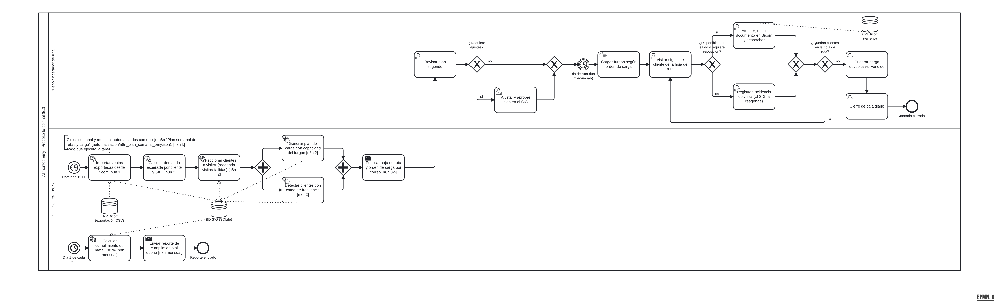

# 02. BPMN to-be final y automatización

Archivos: `bpmn/to-be-final-e2.bpmn` (BPMN 2.0 XML, se abre y edita en <https://demo.bpmn.io> o Camunda Modeler), `bpmn/to-be-final-e2.png` / `.svg` (render del mismo archivo).

## 1. Estructura

Un pool Alimentos Emy con dos lanes:

| Lane | Quién | Tipo de tareas |
|---|---|---|
| Dueño / operador de ruta | Eduardo hoy; un vendedor delegado mañana (RF10) | tareas de usuario y manuales |
| SIG (SQLite + n8n) | la base de datos y el flujo n8n | tareas de servicio y de envío, todas automatizadas |

Dos almacenes de datos externos: ERP Bicom (exportación CSV) y App Bicom (terreno); uno interno: BD SIG (SQLite).

## 2. Ciclo semanal (evento temporizador "Domingo 19:00")

| # | Tarea BPMN | Lane | Tipo | Implementación | Tablas que lee → escribe |
|---|---|---|---|---|---|
| 1 | Importar ventas exportadas desde Bicom | SIG | servicio | nodo n8n 1, `importar_ventas_bicom.sql` | `stg_venta_bicom` → `visita`, `venta`, `detalle_venta` |
| 2 | Calcular demanda esperada por cliente y SKU | SIG | servicio | nodo n8n 2, `generar_plan_semanal.sql` paso 3 | `visita`, `detalle_venta`, `parametro` |
| 3 | Seleccionar clientes a visitar (reagenda visitas fallidas) | SIG | servicio | nodo n8n 2, paso 2 | `ruta_cliente`, `cliente`, `visita` |
| 4a | Generar plan de carga con capacidad del furgón | SIG | servicio | nodo n8n 2, paso 4-5 | `producto`, `vehiculo` → `plan_carga`, `plan_carga_detalle`, `plan_visita` |
| 4b | Detectar clientes con caída de frecuencia | SIG | servicio | nodo n8n 2, paso 6 | `visita` → `alerta_cliente` |
| 5 | Publicar hoja de ruta y orden de carga por correo | SIG | envío | nodos n8n 3-5, `plan_json.sql` | `plan_*`, `alerta_cliente` |
| 6 | Revisar plan sugerido → ¿Requiere ajustes? → Ajustar y aprobar | Dueño | usuario | correo + `plan_carga.estado = 'APROBADO'` | `plan_carga` |
| 7 | (Evento intermedio "Día de ruta") Cargar furgón según orden de carga | Dueño | manual | orden de carga del correo | - |
| 8 | Visitar siguiente cliente → ¿Disponible, con saldo y requiere reposición? | Dueño | usuario | hoja de ruta | - |
| 9a | Atender, emitir documento en Bicom y despachar | Dueño | usuario | App Bicom (se importa el domingo siguiente) | Bicom |
| 9b | Registrar incidencia de visita (el SIG la reagenda) | Dueño | usuario | `visita.resultado` ≠ VENTA | `visita` |
| 10 | ¿Quedan clientes? → Cuadrar carga devuelta vs. vendido → Cierre de caja | Dueño | usuario | - | - |

4a y 4b corren en paralelo (compuerta AND) y se juntan antes de publicar.

## 3. Ciclo mensual (evento temporizador "Día 1 de cada mes")

| Tarea BPMN | Implementación |
|---|---|
| Calcular cumplimiento de meta +30 % | rama mensual de n8n, `cumplimiento_json.sql` (misma lógica que Q1) |
| Enviar reporte de cumplimiento al dueño | nodos n8n *Armar reporte de cumplimiento* → *Enviar reporte al dueño* |

## 4. Cambios respecto del to-be de la E1 y por qué

| Cambio | Motivo |
|---|---|
| El lane "Sistema propuesto" pasa a "SIG (SQLite + n8n)" y sus tareas se marcan como tareas de servicio con el número de nodo n8n que las ejecuta `[n8n k]` | Hacer explícito qué se automatiza y trazarlo al flujo exportado |
| Evento de inicio de la semana pasa a "Domingo 19:00" | Coincide con el hábito del dueño de planificar el domingo en la noche (RNF6) |
| Se agrega "Importar ventas exportadas desde Bicom" como primera tarea | En la E1 el historial se "obtenía"; en la E2 se especifica la ingesta incremental (RF1) |
| "Agrupar clientes por zona" desaparece como tarea | La agrupación quedó resuelta en el modelo de datos (`ruta.id_zona`, `cliente.id_zona`) y no se recalcula cada semana |
| "Generar sugerencia de ruta + mix" se separa en seleccionar clientes y generar plan de carga con capacidad | Son dos cálculos distintos (RF4 y RF5/RF6) con salidas en tablas distintas |
| Compuerta paralela entre plan y alertas | La detección de caída de frecuencia es independiente del plan |
| Compuerta "¿Requiere ajustes?" + "Ajustar y aprobar plan" | El plan es una sugerencia: el dueño conserva la decisión final (y queda registrada con `estado = 'APROBADO'`) |
| Evento intermedio temporizador "Día de ruta" | Separa la planificación (domingo) de la ejecución (lun-mié-vie-sáb) |
| "Hablar con el cliente / reagendar / Fin: venta perdida" se reemplaza por "Registrar incidencia (el SIG la reagenda)" | El SIG reprograma automáticamente: un cliente sin compra vuelve al plan siguiente (la selección usa la última *compra*, no la última visita) |
| "Resolver por improvisación" se elimina | Con orden de carga y hoja de ruta estandarizadas, el imprevisto se registra como incidencia en vez de resolverse "de guata" |
| Se agrega "Cuadrar carga devuelta vs. vendido" antes del cierre de caja | En el as-is la mercadería no se cuadraba diariamente (riesgo de merma identificado en la E1) |
| Ciclo mensual: "Comparar venta real vs. meta" pasa a tarea de servicio automatizada en n8n | Antes no estaba implementado; ahora es la rama mensual del flujo |

Diagramas de la E1 para comparación: [`img/as-is-e1.png`](img/as-is-e1.png), [`img/to-be-e1.png`](img/to-be-e1.png).
