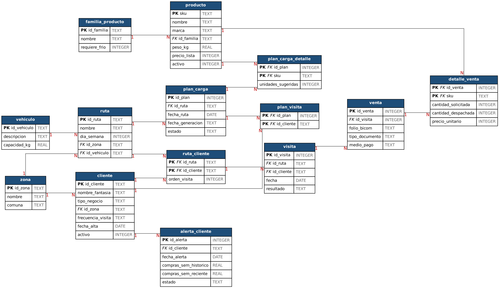

# 03. Modelo de datos: ER en 3FN y diccionario de datos

Implementación: `db/schema.sql` (SQLite 3). Diagrama generado desde la base real con `scripts/er.py`:

## 1. Entidades (15 tablas + 1 tabla de paso + 1 vista)

| Grupo | Tabla | Filas en seed | Rol en el proceso |
|---|---|---|---|
| Configuración | `parametro` | 6 | Parámetros del modelo (meta 30 %, ventanas, factor de seguridad, umbral de alerta) |
| Maestros | `zona`, `cliente`, `familia_producto`, `producto`, `vehiculo` | 4, 45, 7, 21, 1 | Cartera, catálogo y restricción física |
| Planificación base | `ruta`, `ruta_cliente` | 4, 45 | Rutas fijas por día y orden de visita |
| Transacciones | `visita`, `venta`, `detalle_venta` | 2 742, 2 309, 16 945 | Ejecución de la autoventa (desde Bicom) |
| Salidas del SIG | `plan_carga`, `plan_carga_detalle`, `plan_visita`, `alerta_cliente` | generadas por `generar_plan_semanal.sql` | Plan semanal, hoja de ruta y alertas |
| Integración | `stg_venta_bicom` | 0 (se vacía) | Copia plana del CSV de Bicom; no es parte del modelo 3FN |
| Vista | `v_linea_venta` | - | Une las 5 tablas transaccionales para las consultas; los montos se derivan, no se guardan |

## 2. Relaciones y cardinalidades

| Relación | Card. | Implementación |
|---|---|---|
| zona - cliente | 1:N | `cliente.id_zona` FK |
| zona - ruta | 1:N | `ruta.id_zona` FK (cada ruta cubre un cuadrante) |
| vehiculo - ruta | 1:N | `ruta.id_vehiculo` FK (hoy un solo furgón para todas las rutas) |
| ruta - cliente | N:M | tabla asociativa `ruta_cliente(id_ruta, id_cliente, orden_visita)` |
| ruta_cliente - visita | 1:N | FK compuesta `visita(id_ruta, id_cliente)` |
| visita - venta | 1:0..1 | `venta.id_visita` FK + `UNIQUE` |
| venta - producto | N:M | tabla asociativa `detalle_venta(id_venta, sku, …)` |
| familia_producto - producto | 1:N | `producto.id_familia` FK |
| ruta - plan_carga | 1:N | `plan_carga(id_ruta, fecha_ruta)` `UNIQUE` |
| plan_carga - producto | N:M | `plan_carga_detalle(id_plan, sku, unidades_sugeridas)` |
| plan_carga - cliente | N:M | `plan_visita(id_plan, id_cliente)` (hoja de ruta) |
| cliente - alerta_cliente | 1:N | `alerta_cliente.id_cliente` FK |

## 3. Diccionario de datos

Convenciones: PK clave primaria, *FK* clave foránea, NN no nulo, montos en CLP netos enteros, fechas ISO `AAAA-MM-DD`.

### parametro
| Atributo | Tipo | Reglas | Descripción |
|---|---|---|---|
| clave | TEXT | PK | Nombre del parámetro (p. ej. `META_CRECIMIENTO_INTERANUAL`) |
| valor | REAL | NN | Valor numérico |
| descripcion | TEXT | NN | Explicación para el usuario |

### zona
| Atributo | Tipo | Reglas | Descripción |
|---|---|---|---|
| id_zona | TEXT | PK | Código `Z01`…`Z04` |
| nombre | TEXT | NN, UNIQUE | Cuadrante sectorial (sin direcciones exactas, Ley 21.719) |
| comuna | TEXT | NN | Comuna principal |

### cliente
| Atributo | Tipo | Reglas | Descripción |
|---|---|---|---|
| id_cliente | TEXT | PK, `GLOB 'CLI-[0-9][0-9][0-9]'` | Seudónimo del local |
| nombre_fantasia | TEXT | NN | Etiqueta anonimizada |
| tipo_negocio | TEXT | NN, ∈ {MINIMARKET, ALMACEN, BOTILLERIA, PANADERIA} | Tipo de local |
| *id_zona* | TEXT | NN, FK → zona | Cuadrante del local |
| frecuencia_visita | TEXT | NN, ∈ {SEMANAL, QUINCENAL, MENSUAL} | Frecuencia asignada (RF4) |
| fecha_alta | DATE | NN | Inicio de la relación comercial |
| activo | INTEGER | NN, ∈ {0,1}, def. 1 | Cliente vigente |

### familia_producto
| Atributo | Tipo | Reglas | Descripción |
|---|---|---|---|
| id_familia | TEXT | PK | Código (`LEC`, `QLA`, `QTR`, `MAN`, `YOG`, `HUE`, `ABA`) |
| nombre | TEXT | NN, UNIQUE | Nombre de la familia |
| requiere_frio | INTEGER | NN, ∈ {0,1} | Cadena de frío |

### producto
| Atributo | Tipo | Reglas | Descripción |
|---|---|---|---|
| sku | TEXT | PK | Código interno (igual al de Bicom) |
| nombre, marca | TEXT | NN | Descripción comercial |
| *id_familia* | TEXT | NN, FK → familia_producto | Familia |
| peso_kg | REAL | NN, > 0 | Peso de la unidad de venta (base del cálculo de carga) |
| precio_lista | INTEGER | NN, > 0 | Precio vigente |
| activo | INTEGER | NN, ∈ {0,1} | Producto vigente |

### vehiculo
| Atributo | Tipo | Reglas | Descripción |
|---|---|---|---|
| id_vehiculo | TEXT | PK | `V01` |
| descripcion | TEXT | NN | Tipo de vehículo |
| capacidad_kg | REAL | NN, > 0 | Restricción de carga (RF6). Valor usado: 480 kg (supuesto a validar con el dueño) |

### ruta
| Atributo | Tipo | Reglas | Descripción |
|---|---|---|---|
| id_ruta | TEXT | PK | `R-LUN`, `R-MIE`, `R-VIE`, `R-SAB` |
| nombre | TEXT | NN, UNIQUE | Nombre descriptivo |
| dia_semana | INTEGER | NN, 1-7 (1 = lunes) | Día fijo de la ruta |
| *id_zona* | TEXT | NN, FK → zona | Cuadrante que recorre |
| *id_vehiculo* | TEXT | NN, FK → vehiculo | Vehículo asignado |

### ruta_cliente
| Atributo | Tipo | Reglas | Descripción |
|---|---|---|---|
| *id_ruta* | TEXT | PK, FK → ruta | |
| *id_cliente* | TEXT | PK, FK → cliente | |
| orden_visita | INTEGER | NN, > 0, UNIQUE por ruta | Posición en la secuencia de visita |

### visita
| Atributo | Tipo | Reglas | Descripción |
|---|---|---|---|
| id_visita | INTEGER | PK | |
| *id_ruta*, *id_cliente* | TEXT | NN, FK compuesta → ruta_cliente | Solo se visita a un cliente asignado a la ruta |
| fecha | DATE | NN, formato validado; `UNIQUE (id_cliente, fecha)` | Día de la visita |
| resultado | TEXT | NN, ∈ {VENTA, AUSENTE, SIN_SALDO, SIN_REPOSICION} | Desenlace (incidencias del BPMN) |

### venta
| Atributo | Tipo | Reglas | Descripción |
|---|---|---|---|
| id_venta | INTEGER | PK | |
| *id_visita* | INTEGER | NN, UNIQUE, FK → visita | Visita que originó el documento |
| folio_bicom | TEXT | NN, UNIQUE | Folio emitido en Bicom (clave natural, evita duplicar importaciones) |
| tipo_documento | TEXT | NN, ∈ {BOLETA, FACTURA} | |
| medio_pago | TEXT | NN, ∈ {EFECTIVO, TRANSFERENCIA, TARJETA} | |

### detalle_venta
| Atributo | Tipo | Reglas | Descripción |
|---|---|---|---|
| *id_venta* | INTEGER | PK, FK → venta (ON DELETE CASCADE) | |
| *sku* | TEXT | PK, FK → producto | |
| cantidad_solicitada | INTEGER | NN, > 0 | Lo que el cliente pidió (demanda real) |
| cantidad_despachada | INTEGER | NN, 0 ≤ x ≤ solicitada | Lo que había en el camión (*fill rate*) |
| precio_unitario | INTEGER | NN, > 0 | Precio histórico de esa transacción |

### plan_carga. plan_carga_detalle, plan_visita
| Tabla | Atributo | Reglas | Descripción |
|---|---|---|---|
| plan_carga | id_plan | PK | |
| | *id_ruta*, fecha_ruta | NN, FK → ruta, `UNIQUE (id_ruta, fecha_ruta)` | Un plan por ruta y día |
| | fecha_generacion | NN, def. `datetime('now')` | Momento en que n8n generó el plan |
| | estado | ∈ {SUGERIDO, APROBADO, EJECUTADO} | Decisión del dueño (compuerta "¿Requiere ajustes?") |
| plan_carga_detalle | *id_plan*, *sku* | PK, FK | |
| | unidades_sugeridas | NN, >= 0 | Orden de carga por SKU |
| plan_visita | *id_plan*, *id_cliente* | PK, FK | Clientes programados (hoja de ruta) |

### alerta_cliente
| Atributo | Tipo | Reglas | Descripción |
|---|---|---|---|
| id_alerta | INTEGER | PK; `UNIQUE (id_cliente, fecha_alerta)` | |
| *id_cliente* | TEXT | NN, FK → cliente | |
| fecha_alerta | DATE | NN | Fecha de corte en que se detectó |
| compras_sem_historico | REAL | NN, >= 0 | Compras/semana en las 26 semanas previas (foto) |
| compras_sem_reciente | REAL | NN, >= 0 | Compras/semana en las últimas 8 semanas (foto) |
| estado | TEXT | ∈ {ABIERTA, GESTIONADA, CERRADA} | Seguimiento comercial |

## 4. Normalización: por qué está en 3FN y qué anomalías evita

1FN: todos los atributos son atómicos. No hay listas de productos en una venta ni listas de clientes en una ruta; cada repetición se llevó a una tabla asociativa (`detalle_venta`, `ruta_cliente`, `plan_carga_detalle`, `plan_visita`).

2FN: en las tablas con clave compuesta, cada atributo no clave depende de la clave completa:
- `detalle_venta(id_venta, sku)`: cantidades y precio dependen de *ese producto en esa venta*. El nombre o el peso del producto no están aquí (dependerían solo de `sku`).
- `ruta_cliente(id_ruta, id_cliente)`: `orden_visita` depende del par (un cliente puede tener distinto orden en distintas rutas).
- `plan_carga_detalle(id_plan, sku)`: `unidades_sugeridas` depende del par.

3FN: no hay dependencias transitivas entre atributos no clave:

| Decisión de diseño | Dependencia transitiva que se evita | Anomalía evitada |
|---|---|---|
| `venta` no guarda fecha, cliente ni ruta: se obtienen vía `visita` | `id_venta → id_visita → fecha, id_cliente` | Actualización: corregir la fecha de una visita obligaría a corregir también la venta, con riesgo de que queden distintas |
| Se eliminó `monto_total` de la venta (existía en la E1) | `id_venta → {líneas} → monto_total` | Actualización: modificar una línea dejaría un total inconsistente. El monto se deriva en `v_linea_venta` |
| `producto` guarda `id_familia`, no el nombre de la familia | `sku → id_familia → nombre_familia` | Actualización: renombrar "Leches" exigiría tocar 3 productos |
| `cliente` guarda `id_zona`, no el nombre de zona ni la comuna | `id_cliente → id_zona → comuna` | Inserción: no se podría crear una zona sin cliente; Borrado: borrar el último cliente perdería la zona |
| `ruta` guarda `id_vehiculo`; la capacidad vive en `vehiculo` | `id_ruta → id_vehiculo → capacidad_kg` | Actualización: cambiar de furgón exigiría corregir 4 rutas |
| `plan_carga` guarda `id_ruta`; el día y el vehículo se obtienen de `ruta` | `id_plan → id_ruta → id_vehiculo` | Actualización |
| Constantes del modelo en `parametro` en vez de dentro del código | - | Mantenibilidad (RNF4): cambiar la meta no requiere editar SQL |

Datos que parecen repetidos pero que tienen razón de estar:
- `detalle_venta.precio_unitario` vs. `producto.precio_lista`: no es redundancia. El primero es el precio histórico de la transacción (depende de venta + sku); el segundo es el vigente. Si se derivara, una subida de precio reescribiría las ventas pasadas y falsearía Q1.
- `alerta_cliente.compras_sem_*`: guardan los valores del momento en que se creó la alerta. Si se recalcularan después darían otro número y no se sabría por qué se generó la alerta.
- `cliente.id_zona` y `ruta.id_zona`: no son derivables entre sí porque un cliente puede pertenecer a varias rutas (relación N:M). La consistencia geográfica es una regla operativa, no una dependencia funcional.

## 5. Cambios respecto del modelo preliminar de la E1

| E1 | E2 | Motivo |
|---|---|---|
| `Venta(id_venta, fecha, id_cliente, monto_total)` | Nueva entidad `visita`; `venta` solo con datos del documento | Registrar visitas sin venta (incidencias del BPMN, reagendamiento, efectividad Q6) y eliminar la dependencia transitiva |
| `monto_total` almacenado | Derivado | 3FN |
| `DetalleVenta(id_venta, sku, cantidad)` | `cantidad_solicitada`, `cantidad_despachada`, `precio_unitario` | Medir *fill rate* (KPI de la E1 que no tenía dato) y conservar el precio histórico |
| `PlanCarga(id_ruta, id_familia, cantidad)` | `plan_carga` (encabezado por ruta y fecha) + `plan_carga_detalle` por SKU + `plan_visita` | La E1 no distinguía planes de semanas distintas; por SKU es lo que se carga físicamente (la familia es agregable) |
| `Ruta - Cliente` N:M sin resolver | `ruta_cliente` con `orden_visita` | Resolver N:M y guardar la secuencia (RF4) |
| `AlertaCliente(id_cliente, fecha, variación)` | PK sustituta + fotos de frecuencia + `estado` | Seguimiento de la alerta y evitar guardar un valor derivado (variación) |
| - | `parametro`, `stg_venta_bicom`, triggers R1-R2 | Mantenibilidad, integración con n8n y reglas de negocio |
