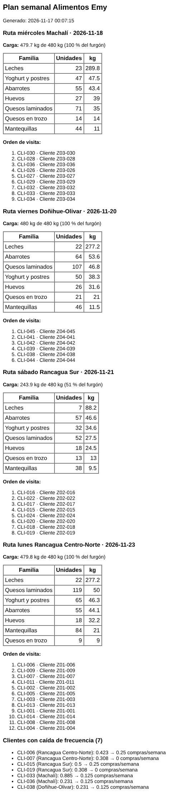
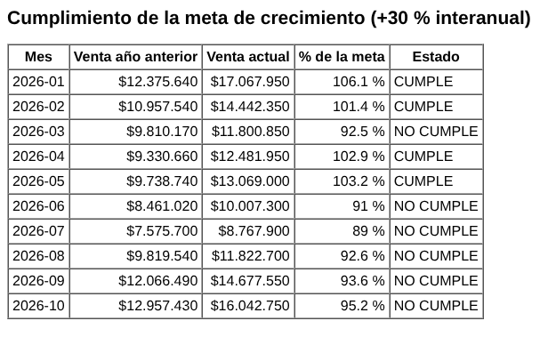

# 05. Automatización con n8n

Flujo exportado: `automatizacion/n8n_plan_semanal_emy.json` (13 nodos, dos ramas). Se probó en n8n 2.x autoalojado; la evidencia de la ejecución está en `automatizacion/evidencia/`.

## 1. ¿Por qué n8n y por qué estos pasos?
El dueño planifica el domingo en la noche con un *planner* de papel. El flujo hace eso por él: a las 19:00 toma la última exportación de Bicom, la carga en la base, ejecuta el algoritmo de planificación y le envía un correo con la hoja de ruta y la orden de carga de la semana. El día 1 de cada mes le envía el cumplimiento de la meta. Con esto, las tareas de servicio del lane SIG del BPMN to-be quedan como nodos que se ejecutan solos.

## 2. Rama semanal: "Plan semanal de rutas y carga"

| # | Nodo n8n | Tipo de nodo | Qué hace | Tarea BPMN to-be | RF |
|---|---|---|---|---|---|
| - | Domingo 19:00 | Schedule Trigger (semanal, domingo 19:00, America/Santiago) | Inicia el ciclo | Evento de inicio "Domingo 19:00" | RNF6 |
| - | Ejecutar ahora (demo) | Manual Trigger | Mismo flujo, para la defensa | - | - |
| - | Configuración | Edit Fields (Set) | Define `repo_path` y `correo_destino` | - | - |
| 1 | Importar ventas Bicom (RF1) | Execute Command | Si existe `data/entrada/export_bicom.csv`, ejecuta `importar_ventas_bicom.sql` y mueve el archivo a `procesados/`; si no, sigue con la historia existente | Importar ventas exportadas desde Bicom | RF1, RNF4 |
| 2 | Generar plan y alertas | Execute Command | Ejecuta `generar_plan_semanal.sql` | Calcular demanda, Seleccionar clientes, Generar plan de carga, Detectar caída de frecuencia | RF2-RF6, RF9 |
| 3 | Leer plan en JSON | Execute Command | `plan_json.sql` devuelve un único JSON con planes y alertas | Publicar hoja de ruta… | RF7 |
| 4 | Armar hoja de ruta (RF7) | Code (JavaScript) | Convierte el JSON en un correo HTML de una columna, legible en celular | Publicar hoja de ruta… | RF7, RNF5 |
| 5 | Enviar plan al dueño | Send Email (SMTP) | Envía el correo | Publicar hoja de ruta… (tarea de envío) | RF7 |

## 3. Rama mensual: "Cumplimiento de meta"

| Nodo n8n | Tipo | Qué hace | Tarea BPMN to-be | RF |
|---|---|---|---|---|
| Día 1 de cada mes 08:00 | Schedule Trigger (mensual) | Inicia el ciclo | Evento de inicio "Día 1 de cada mes" | - |
| Configuración mensual | Edit Fields (Set) | Mismos parámetros | - | - |
| Calcular cumplimiento meta (RF8) | Execute Command | `cumplimiento_json.sql` (misma lógica que Q1) | Calcular cumplimiento de meta +30 % | RF8 |
| Armar reporte de cumplimiento | Code (JavaScript) | Tabla HTML de los últimos 12 meses | Enviar reporte de cumplimiento | RF8 |
| Enviar reporte al dueño | Send Email (SMTP) | Envía el correo | Enviar reporte de cumplimiento | RF8 |

## 4. Paso a paso para reproducirlo

1. Instalar n8n (una opción): `npx n8n` o Docker (`docker run -it --rm -p 5678:5678 -v ~/.n8n:/home/node/.n8n n8nio/n8n`). Con Docker, montar también la carpeta del repo y verificar que `sqlite3` exista dentro del contenedor.
2. Habilitar el nodo Execute Command. En n8n 2.x viene deshabilitado por seguridad: iniciar n8n con la variable de entorno `NODES_EXCLUDE="[]"`.
3. Crear la base siguiendo el `README.md` (pasos 1-2).
4. En n8n: *Workflows → Import from file* → `automatizacion/n8n_plan_semanal_emy.json`.
5. Editar los nodos Configuración y Configuración mensual: `repo_path` = ruta absoluta del repo clonado; `correo_destino` = correo del dueño.
6. Crear una credencial SMTP en n8n y asignarla a los dos nodos *Send Email* (la credencial no se versiona, RNF2).
7. (Demo) Copiar `data/samples/export_bicom_ejemplo.csv` a `data/entrada/export_bicom.csv`.
8. Pulsar Execute workflow desde *Ejecutar ahora (demo)*. Para dejarlo operativo, activar el flujo (los disparadores programados corren solos).

## 5. Evidencia de ejecución

Ejecutado el 17-nov-2026 con n8n 2.x (CLI `n8n execute`), sin los nodos de correo (no se usó un servidor SMTP real):

| Rama | Nodos ejecutados | Estado | Tiempo nodos SQL | Archivo |
|---|---|---|---|---|
| Semanal | 6 de 6 | todos `success` | 48 ms + 56 ms + 19 ms | `evidencia/ejecucion_semanal.json` |
| Mensual | 4 de 4 | todos `success` | 46 ms | `evidencia/ejecucion_mensual.json` |

El HTML que el flujo generó para el correo está en `evidencia/correo_semanal.html` y `evidencia/correo_mensual.html` (capturas en `docs/img/`). El CSV de ejemplo se importó, la línea con SKU inválido fue rechazada y el archivo se movió a `data/entrada/procesados/`.

 

## 6. Limitaciones conocidas
- La exportación desde Bicom es manual: el dueño debe dejar el CSV en `data/entrada/`. Bicom no ofrece (al menos en el plan de la PYME) una API documentada; una mejora sería un nodo *Google Drive Trigger* que tome el archivo desde una carpeta compartida.
- El ajuste del plan (compuerta "¿Requiere ajustes?") no tiene interfaz: hoy se responde el correo o se actualiza `plan_carga.estado`. Se podría mejorar con un nodo *n8n Form* para aprobar o cambiar cantidades.
- El flujo usa Execute Command, por lo que n8n debe correr en el mismo equipo que la base SQLite.
